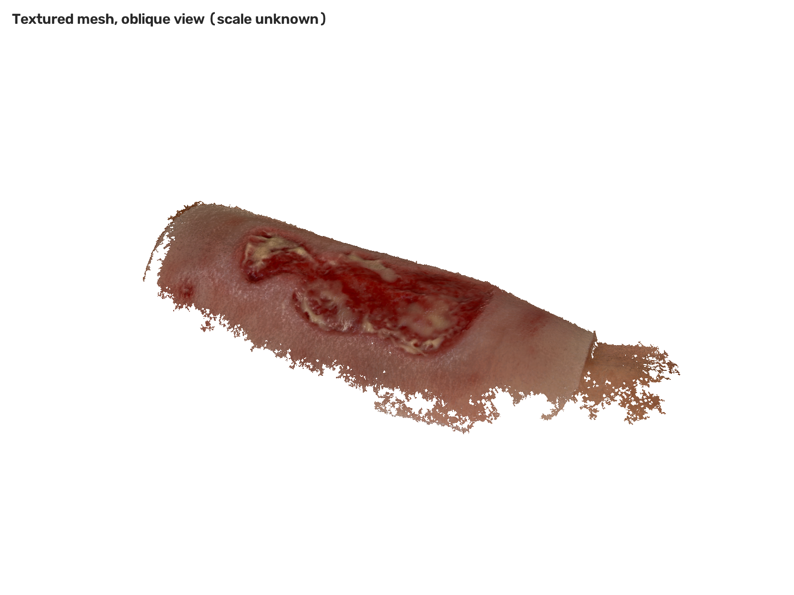
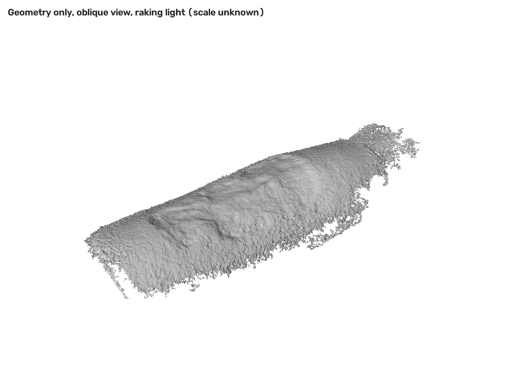
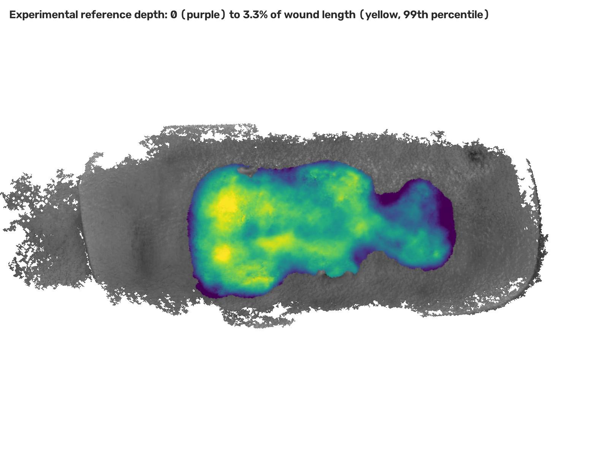

# Camera calibration and 3D wound reconstruction

**Dilip Goswami**

A CPU-based photogrammetry pipeline that calibrates the iPhone 13 Pro Max main
camera and reconstructs a silicone wound moulage from RGB photographs. Outputs
include calibrated camera parameters, sparse and dense point clouds, a
vertex-coloured mesh and PLY files for inspection in MeshLab or CloudCompare.
Experimental wound descriptors quantify sensitivity to the boundary and fitted
reference surface.

Results are expressed in reconstruction units. The metrics and gallery below come
from one complete execution of the current implementation on 4 November 2026.
Physical scale, measurement assumptions and validation limits are documented below.

[Gallery](#reconstruction-gallery) · [Quick start](#quick-start) · [Method](#method) · [Results](#results) ·
[Inspect outputs](#inspect-outputs) · [Physical scale](#physical-scale) ·
[Reproducibility](#reproducibility-and-verification) · [Development](#development)

## Reconstruction gallery

Colour, geometry and depth views of the **150,887-vertex reconstructed mesh**.
The subject is a silicone wound phantom. Depth colours represent displacement below
a fitted reference surface in reconstruction units.

<p align="center">
  
</p>

| Surface geometry | Experimental depth |
|---|---|
|  |  |
| Neutral shading exposes relief and open outer boundaries. | Purple is zero; yellow is P99, about 3.0% of wound length. |

Open an image for full resolution. The preview files are unchanged pipeline outputs;
[PLY files and inspection instructions](#inspect-outputs) are described below.

## Quick start

Use **Python 3.13** for the pinned environment. The recorded execution used Python 3.13.5
on macOS arm64 with four OpenCV threads. The package declares Python 3.12+ support;
the supplied lock file was resolved for Python 3.13. No GPU, model training,
pretrained weights or remote image service is required.

Keep the supplied data outside the repository:

```text
workspace/
├── checkerboard/                  # 22 calibration photographs
├── images/                        # 23 wound photographs
└── araias-wound-reconstruction/    # source repository
```

From the repository root:

```sh
python3.13 -m venv .venv
.venv/bin/python -m pip install -r requirements.lock.txt
.venv/bin/python -m pip install --no-deps -e '.[dev]'

.venv/bin/wound-reconstruct --data-root .. --output-dir outputs --threads 4
.venv/bin/wound-verify --output-dir outputs --data-root ..
```

Use a fresh output directory per full run and a separate virtual environment per
checkout. Configuration is in `configs/default.yaml`; packaged defaults are in
`src/woundrecon/resources/default.yaml`. Use one OpenCV distribution:
`opencv-python-headless`.

Logs and `run_manifest.json` record stage outcomes, configuration, source/input
hashes, library versions and artifact hashes. PDF typesetting is separate.

## Method

```text
audit → calibrate → sfm → dense → mesh → scale → measure → render
```

| Stage | Responsibility |
|---|---|
| `audit` | Check resolution, orientation, colour profile, exposure, sharpness and highlights |
| `calibrate` | Detect corners; compare five lens models on held-out views; bootstrap uncertainty |
| `sfm` | RootSIFT matching, verified tracks, incremental camera registration and robust bundle adjustment |
| `dense` | Rectified SGBM stereo; try ranked reserves until six usable partners or candidate exhaustion; fuse depths agreeing across two pairs |
| `mesh` | TSDF fusion and marching cubes; require all eight cell corners to have support from at least two depth maps |
| `scale` | Validate a supplied scale reference and align geometry to the inspection frame |
| `measure` | Estimate heuristic wound labels; fit a periwound reference; integrate descriptors and test definition sensitivity |
| `render` | Produce photographic-colour, neutral-geometry, depth and camera views |

Key decisions:

- **Coordinates and colour:** map images to the native sensor frame; use half-resolution
  features/stereo and report reprojection errors in native pixels. Average colours
  in linear light.
- **Observation support:** retain missing regions rather than fabricate surfaces.
  Release fails when an open edge touches the saved heuristic wound mask. Pair
  estimates share images/cameras and are correlated.
- **Geometry checks:** require finite/unit normals and at least 95% agreement with
  triangle winding by both face count and area. XYZ uses float64, normals float32
  and RGB uint8.
- **Traceability:** bind caches to inputs, settings, code and libraries. Partial reruns
  require unchanged upstream dependencies and label reused stages in the manifest.

## Results

Recorded execution: **4 November 2026**, Python 3.13.5, macOS arm64, four OpenCV
threads. All eight pipeline stages completed and saved-output verification passed.

| Evidence | Recorded result |
|---|---|
| Calibration | 22/22 boards; fit RMS 0.528 px; mean held-out RMS 0.608 px |
| Registered wound photographs | 23/23 |
| Sparse landmarks | 12,353 raw; 3,481 exported with observations in at least three views |
| Accepted reference depth maps | 22/23 |
| Dense cloud after voxel aggregation | 2,876,364 points |
| Thinned inspection cloud | 553,189 points |
| Mesh vertices / triangles | 150,887 / 285,063 |
| Components / non-manifold edges | 1 / 0 |
| Open edges | 20,621 total; 0 touching the saved wound mask |
| Normal/winding agreement, faces / area | 99.45% / 99.57% |
| Sparse-to-mesh distance within footprint | Median 0.257% of wound length; P95 1.158% |
| Hashed inspection renders | 5 PNGs |
| Saved-output verification | Passed |
| Measurement status / units | Uncertain / reconstruction units |

`dense/dense.ply` contains the final **2,876,364-point cloud**. The dense
stage records 10,293,539 samples after spatial filtering and before voxel
aggregation; overlapping views contribute repeated surface observations. These
samples are not the final cloud size. The 553,189-point cloud is a separate,
thinned export for inspection. Counts are recorded in `dense/dense_stats.json` and
`verification.json`.

Sparse-to-mesh agreement is internal consistency under shared camera/image
assumptions; it is not independent surface accuracy. Zero wound-mask open edges is
a coverage check under a heuristic mask, not a clinical boundary validation.

### Calibration and uncertainty

Intrinsics use the native **4032 × 3024** landscape sensor frame:

```text
K = [[3081.934,    0.000, 1982.549],
     [   0.000, 3074.910, 1510.107],
     [   0.000,    0.000,    1.000]]

distortion [k1, k2, p1, p2, k3] = [0.236163, -1.315694, 0, 0, 2.369599]
```

The selected model uses three radial terms with tangential terms fixed at zero.
Model selection chooses the simplest fit within 2% of the lowest held-out error:
the five-coefficient model scored 0.599 px versus 0.608 px for the radial model.
Shared target geometry is refined by release-object calibration; improved prediction
does not establish the physical cause of the improvement.

Camera/target fits exclude each held-out view. Pose uses even-index corners and
scoring uses odd-index corners; the score averages per-view RMS values. Rational
fits are controls; reconstruction rejects unsupported distortion vectors rather
than silently dropping coefficients.

| Bootstrap SD | fx | fy | cx | cy | k1 | k2 | k3 |
|---|---|---|---|---|---|---|---|
| Value | 15.7 px | 19.0 px | 17.3 px | 3.3 px | 0.013 | 0.120 | 0.327 |

Boards occupy **45.3%** of a diagnostic sensor grid. Conditional bootstrap
pixel-displacement SD is 0.145 px centrally and 76.9 px at a sensor corner: precision
under the model, not measured physical error. Feature extraction limits extrapolation
to 1.25 times the observed corner radius.

Fixed checkerboard intrinsics were retained for reconstruction: the paired held-out
difference interval included zero. Camera controls are rebuilt on training images
and compared on common held-out associations with disjoint pose/scoring partitions.

### Experimental wound descriptors

For nominal wound length **L = 3.730 reconstruction units**:

| Descriptor | Nominal | Definition sensitivity |
|---|---|---|
| Width | 0.517 L | 0.497–0.517 L |
| Projected area | 0.373 L² | 0.336–0.394 L² |
| Depth P99 | 0.02996 L | 0.02868–0.05012 L |
| Volume below fitted reference | 0.005905 L³ | 0.004734–0.011916 L³ |

Each variant uses its own wound length. These one-at-a-time ranges are not confidence
intervals. Depth is measured along canonical z; P99 is the projected-area-weighted
percentile of clipped triangle mean depths. The intact reference surface is inferred,
and the boundary is unreviewed. These are not validated clinical measurements.

## Inspect outputs

Paths below are relative to the selected output directory. Full geometry is
produced by the pipeline; the repository includes three rendered previews in
`assets/previews/`. Input photographs and full reconstruction files are excluded
from version control.

| Artifact | Purpose |
|---|---|
| `scale/mesh_aligned.ply` | Vertex-coloured mesh; x along the forearm, z towards the cameras |
| `scale/dense_aligned_thinned.ply` | Dense inspection cloud in the same frame |
| `scale/sparse_aligned.ply` | Exported sparse landmarks in the same frame |
| `scale/cameras_aligned.ply` | Registered camera frusta in the same frame |
| `measure/wound_depth.ply` | Same mesh with experimental depth colours |
| `dense/dense.ply` | Final dense cloud in the original SfM frame |
| `dense/dense_stats.json` | Accepted depth maps and pre-/post-aggregation point counts |
| `renders/*.png` | Colour, neutral geometry, depth and camera views |
| `calibration/calibration.json` | Intrinsics, distortion, fit errors and bootstrap uncertainty |
| `calibration/bootstrap_samples.npz` | Recorded parameter draws and spatial displacements |
| `measure/measurements.json` | Descriptor definitions, sensitivity and status |
| `verification.json`, `run_manifest.json` | Release checks and run lineage |

Import the aligned PLYs together in MeshLab or CloudCompare. To inspect relief,
disable vertex colours on `mesh_aligned.ply` and use directional lighting. The full
dense cloud requires the transform in `scale/scale.json` before overlaying; read
units from that JSON and the PLY headers.

Start with `01_textured_top.png`, `02_geometry_oblique.png` and
`05_textured_oblique.png` in `renders/`. Photographic texture alone can conceal
geometry defects.

## Physical scale

Scaling the scene and camera positions together preserves monocular projections.
A verified physical length is therefore required for metric scale. No reference
with a confirmed size was established in the wound photographs. The calibration
board is absent from those views and its square size was unspecified.

A search over eight ArUco/AprilTag dictionaries found no coded marker; this does not
exclude an uncoded reference. A verified manufacturer dimension or measurement
between identifiable, rigid features of the moulage can provide a scale source.

Set one source in `configs/default.yaml`, then run the full pipeline into a new
output directory:

| Setting | Required reference |
|---|---|
| `scale.marker_side_mm` | Measured ArUco/AprilTag marker visible in the photographs |
| `scale.reference_annotation` | Measured rigid segment with endpoints marked in at least two photographs |
| `scale.known_length_mm` + `scale.reference_points` | Measured separation of two points in `dense/dense.ply` |

Annotation example, using original displayed-image pixels; values are illustrative:

```json
{
  "description": "Measured rigid segment",
  "length_mm": 20.0,
  "observations": [
    {"image": "IMG_0001.png", "endpoint_a": [100, 200], "endpoint_b": [300, 200]},
    {"image": "IMG_0002.png", "endpoint_a": [120, 210], "endpoint_b": [310, 205]}
  ]
}
```

Annotation paths are relative to the data root. References must be finite, positive
and non-degenerate. Image-based references also require parallax, positive camera
depth and acceptable reprojection error. Validate the scale against a separate
measured length excluded from fitting and report reference/endpoint uncertainty.
A 1% scale error contributes about 2% area and 3% volume error, before shape errors.

## Reproducibility and verification

Use a fresh output directory for each full execution and retain its manifest with
the exported models and report. The manifest records the numerical source files,
input images, settings, library versions and output hashes, including all five
rendered views. For the recorded execution, the inventory covers
30 package source files, 45 input images and 103 output artifacts.

Verify saved outputs using the source snapshot that generated them. Source
fingerprints prevent mixing artifacts from different implementations; changes to
documentation or package metadata do not alter the numerical-code fingerprint.
Use each run's own measurements when preparing its report.

### Validation safeguards

| Check | Behaviour |
|---|---|
| Bundle-adjustment acceptance | Evaluate candidates on copied camera, pose and point state. Rejection or validation exceptions preserve retained state. Report candidate and retained RMS separately and reject negative solver statuses. |
| Render integrity | Writers and artifact inventories share the same folder mapping and hash all five PNGs. A real-renderer regression alters a copied PNG and requires verification to fail. |
| Stereo support | Try ranked reserves until six usable partners are found or candidates are exhausted. Apply the configured disparity, agreement and TSDF support thresholds. |

### Repeating the experiment

Use the pinned environment, input image bytes, configuration and thread count.
Randomised steps are seeded, but native numerical execution and threshold decisions
can still change the camera solution, accepted support and output counts. Compare
coverage, topology and descriptor definitions alongside numerical values; the
recorded metrics are individual run results, not predefined acceptance tolerances.

Verification establishes saved-file integrity and configured software/geometry
checks. Independent reference geometry is needed to measure physical accuracy.

## Development

Run the synthetic suite and static checks without task images:

```sh
.venv/bin/python -m pytest -q
.venv/bin/ruff check src tests scripts
.venv/bin/ruff format --check src tests scripts
.venv/bin/python -m pip check
```

The current suite has **73 tests** covering calibration, projection, stereo,
bundle-adjustment failure paths, TSDF support/normals, integration, scale, PLY
precision, cache invalidation, release rejection, rendering/tamper detection and
packaging. Tests establish specified software behaviour, not physical accuracy.

The [source-quality workflow](https://github.com/goapu/araias-wound-reconstruction/actions/workflows/quality.yml)
runs on pushes and pull requests, or manually. It checks dependencies, lint/format,
synthetic tests, wheel construction, packaged defaults and all three installed CLI
entry points. Its result applies to the source version tested.

## Packaging results

Package a verified run with an existing PDF describing that same run:

```sh
.venv/bin/wound-export --output-dir outputs \
  --report /path/to/report.pdf --dest submission
```

The exporter validates the run, PDF and inspection images, then creates the report
copy, source/model ZIPs, screenshots, metrics and SHA-256 inventory. The source
archive uses an allowlist to exclude task data, derived assets and credentials;
inspection images are included separately in the delivery. The gallery above is
available in the repository. Source-checkout wrappers for all three commands are in `scripts/`.

## Repository layout

```text
.github/workflows/quality.yml  automated source and package checks
assets/previews/              three recorded-run inspection renders
configs/default.yaml          pipeline settings
src/woundrecon/                numerical modules, CLI and stage orchestration
  stages/                     audit, calibrate, sfm, dense, mesh, scale, measure, render
  resources/default.yaml      installed-package defaults
tests/                        synthetic unit, regression and integration checks
scripts/                      source-checkout command wrappers
pyproject.toml                package metadata, dependencies and lint settings
requirements.lock.txt         pinned development environment
.editorconfig, .gitattributes text formatting and line-ending rules
```

Each stage module orchestrates work; numerical modules implement calibration,
geometry and measurement. `provenance.py` and `reuse.py` bind dependencies;
`validation.py` checks saved outputs; `delivery.py` assembles verified exports.

## Limitations and next steps

| Limitation | Observed consequence | Next step |
|---|---|---|
| Unverified scene scale | Length, area and volume remain in reconstruction units | Measure a rigid in-scene reference and validate on a separate length |
| Peripheral calibration uncertainty | Distortion extrapolation is unstable near sensor corners | Use a rigid target with varied tilt, distance and edge/corner coverage at the intended focus |
| Limited stereo feasibility | One registered photograph has no accepted depth map because every attempted partner exceeded the disparity-search budget | Investigate pose/orientation and acquisition geometry; assess wider search against memory and computation cost |
| Incomplete observation support | Outer boundaries remain open and irregular | Improve viewpoint coverage and evaluate completeness against reference geometry |
| Heuristic boundary and inferred intact surface | Depth/volume depend on the definition; measurement status remains uncertain | Obtain expert-reviewed boundaries and measured phantom geometry |
| One phantom and capture setting | Generalisation to clinical scenes is untested | Evaluate diverse authorised captures across sessions, operators and devices |

Unlocked focus/exposure, specular regions and possible motion can also affect
correspondence and shape. Point count and smooth appearance do not establish
accuracy. Define error/completeness tolerances before benchmarking, and request
recapture when observation support is inadequate.

## Methods and tools

[Zhang calibration](https://doi.org/10.1109/34.888718) ·
[Imperfect-target calibration](https://doi.org/10.1109/ICCVW.2011.6130369) ·
[SIFT](https://www.cs.ubc.ca/~lowe/papers/ijcv04.pdf) ·
[RootSIFT](https://www.robots.ox.ac.uk/~vgg/publications/2012/Arandjelovic12/arandjelovic12.pdf) ·
[Bundle adjustment](https://doi.org/10.1007/3-540-44480-7_21) ·
[Semi-global matching](https://doi.org/10.1109/TPAMI.2007.1166) ·
[TSDF fusion](https://graphics.stanford.edu/papers/volrange/)

Built with OpenCV, NumPy, SciPy, scikit-image, Pillow, Matplotlib, PyYAML and pypdf.
